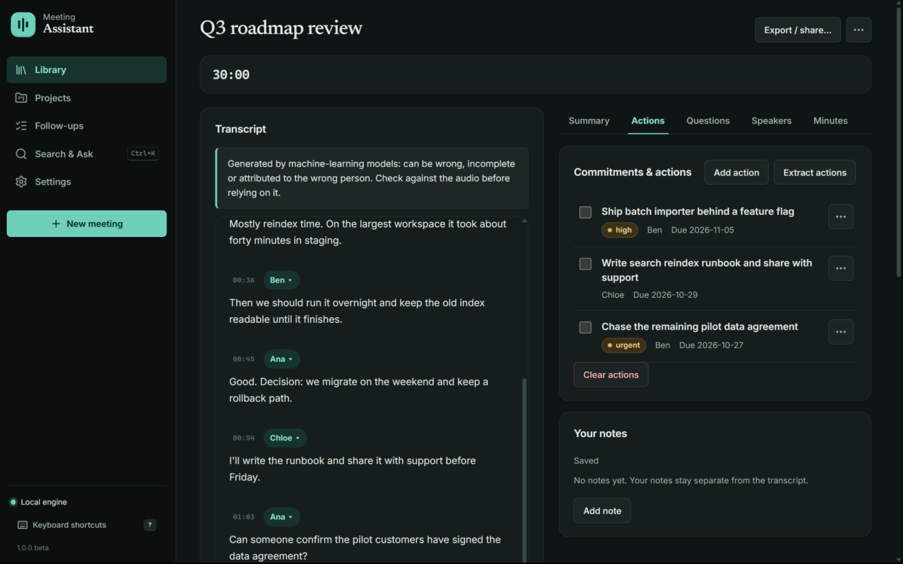
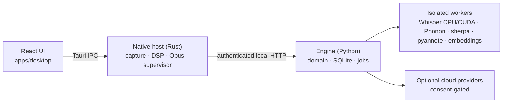

# Meeting Assistant

A local-first desktop notebook for meetings. It captures microphone and system
audio and transcribes it on your machine (Whisper on CPU, or an optional CUDA
runtime). Each transcript line keeps its speaker and timestamp. Actions,
decisions and follow-ups link back to the moment they were said.
There are no meeting bots and no hosted account: nothing is captured until you press Start.

> Development project, not a verified public release.

<p align="center">
  
</p>

| Meeting library | Follow-ups across meetings |
|---|---|
|  |  |

| Search with transcript evidence |
|---|
|  |

Screenshots use a synthetic demo workspace; no real meeting data.

## What it does

- **Capture:** WASAPI microphone and system loopback with pause, resume, crash recovery and source-loss gaps recorded in the timeline. Recording to disk is opt-in.
- **Transcription:** Whisper runs in isolated worker processes on CPU (INT8). An optional CUDA runtime pack was measured about 9× faster on an RTX 4060 Ti. Phonon-2.5 (a 156 MB, 25-language Parakeet derivative) runs on CPU with word timings. There are also adapters for sherpa (Parakeet), Deepgram, AssemblyAI and Azure; cloud providers are consent-gated.
- **Editable evidence:** you can edit transcript text and speakers, with revision history, undo, and notes anchored to transcript moments.
- **Outcomes:** actions, decisions, risks and important moments, each citing its source utterance. Follow-ups can be filtered across meetings.
- **Search & Ask:** keyword search and optional semantic search over the workspace. Answers cite transcript excerpts.
- **Export and backup:** Markdown, PDF and SRT export; hash-verified backup and restore.

## Architecture



- `engine/`: Python 3.12 engine, SQLite with migrations, command registry and HTTP transport.
- `crates/`: audio backends (WASAPI; experimental CoreAudio and PipeWire), SpeexDSP and Silero VAD, Opus media, worker protocol.
- `apps/desktop/`: React with TanStack Query, plus the Tauri 2 host.
- `workers/`: independently locked, frozen inference workers.
- `engine/contracts/`: OpenAPI, JSON Schema, TypeScript and Rust types generated from the engine.
- `engine/prompts/`, `engine/catalog/`: versioned prompt templates and model/runtime manifests.

## Platform status

| Platform | Status | Intended system-audio backend |
|---|---|---|
| Windows 11 x86-64 | Primary verification target; see recorded acceptance evidence | WASAPI shared-mode loopback |
| macOS 15+ arm64/x86-64 | **Experimental and untested** | ScreenCaptureKit audio and CoreAudio microphone |
| Ubuntu 24.04 x86-64 | **Experimental and untested** | PipeWire monitor nodes |

macOS and Linux cannot currently be tested by the maintainer in this environment.
Source presence or successful compilation is not a guarantee of capture,
permissions, playback, packaging or update behavior on those systems.

## Development

Required toolchains are pinned in `engine/.python-version`,
`apps/desktop/.node-version` and `rust-toolchain.toml`. Install Python 3.12.10, Node 24.22.1, Rust 1.94.0, uv 0.13.5
and just 1.59.0. Windows native builds additionally require Visual Studio C++
build tools and WebView2. Native codec SDK prerequisites are documented in
[platform setup](docs/platforms.md).

```text
just bootstrap
just dev
```

The engine is a Python package under `engine/meeting_assistant`; the React
application is in `apps/desktop`; the Tauri host and native audio/media crates
are separate from engine business logic. Workspaces use application-data
locations, never an implicit database in the current working directory.

## Verification

```text
just check
just test
just smoke
just build
just package
just release-check
```

These commands propagate failures. `smoke` exercises a real local engine,
native deterministic file-source processing, and the actual browser surface.
It does not replace real microphone/system capture, credentialed provider,
installed-desktop, OAuth or signed-upgrade acceptance. Command receipts are
written under ignored `artifacts/`; missing acceptance evidence is not a pass.

## Privacy and inference

Capture always needs an explicit Start. Retained recording is separately
opt-in and off by default; recording off must not create an audio crash journal.
Optional AI, embeddings and diarization must not prevent basic notebook use.
The selected ASR must be ready before capture transcription starts; no silent
provider switch is permitted.

Large models and inference runtimes require explicit acquisition. An empty
installation is not offline-inference-ready. Connections use user-provided
credentials and declared destinations; no project-operated inference account
or company gateway is required. Cloud processing and delivery are distinct
consents. Read [privacy](docs/privacy.md) before using real meeting data.

Source and identity-less developer builds can explicitly install a first-party
worker into a private, workspace/model-scoped native-code registry. This is a
separate developer action, not an unsigned official catalog or an executable
model import. See [Windows developer setup](docs/providers.md#windows-developer-worker-setup).
It does not make an empty installation ready or satisfy signed-release gates.

## Distribution

`release.toml` is the version and publisher-identity authority. Its empty
publisher, OAuth and signing inputs must be supplied by the actual publisher;
no fake owner/repository, production key or registration is bundled. Developer
builds and official signed releases are different. Release checks fail until
required identities, credentials, actual installers and acceptance evidence
are present. No publishing or paid service is performed by developer recipes.

Original application source uses MIT. Dependencies, codecs and model weights
retain their own licenses; see the generated artifact inventories.

## Model credits

No model weights ship in the installer. Each model is downloaded on request,
pinned to an exact revision, after you accept its license.

| Model | Author | License | Changes |
|---|---|---|---|
| [Whisper small](https://huggingface.co/Systran/faster-whisper-small) | OpenAI; CTranslate2 conversion by SYSTRAN | [MIT](https://github.com/openai/whisper/blob/main/LICENSE) | Format conversion only |
| [Whisper large-v3-turbo](https://huggingface.co/mobiuslabsgmbh/faster-whisper-large-v3-turbo) | OpenAI; CTranslate2 conversion by Mobius Labs | [MIT](https://github.com/openai/whisper/blob/main/LICENSE) | Format conversion only |
| [Whisper large-v3](https://huggingface.co/Systran/faster-whisper-large-v3) | OpenAI; CTranslate2 conversion by SYSTRAN | [MIT](https://github.com/openai/whisper/blob/main/LICENSE) | Format conversion only |
| [Parakeet TDT 0.6B v3](https://huggingface.co/nvidia/parakeet-tdt-0.6b-v3) | NVIDIA | [CC BY 4.0](https://creativecommons.org/licenses/by/4.0/) | Converted to ONNX and int8-quantized by the [sherpa-onnx](https://huggingface.co/csukuangfj/sherpa-onnx-nemo-parakeet-tdt-0.6b-v3-int8) project |
| [Phonon-2.5](https://huggingface.co/FermionResearch/Phonon-2.5) | Fermion Research, derived from NVIDIA Parakeet TDT 0.6B v3 | [CC BY 4.0](https://creativecommons.org/licenses/by/4.0/) | Re-trained for 25 languages and compressed by Fermion Research ([NOTICE](https://huggingface.co/FermionResearch/Phonon-2.5/blob/main/NOTICE)) |
| [speaker-diarization-community-1](https://huggingface.co/pyannote/speaker-diarization-community-1) | pyannote | [CC BY 4.0](https://creativecommons.org/licenses/by/4.0/) | None. Gated: each user accepts pyannote's terms on Hugging Face |
| [multilingual-e5-small](https://huggingface.co/intfloat/multilingual-e5-small) | Microsoft (intfloat) | [MIT](https://github.com/microsoft/unilm/blob/master/LICENSE) | None |

Runtimes: [faster-whisper](https://github.com/SYSTRAN/faster-whisper) (MIT),
[sherpa-onnx](https://github.com/k2-fsa/sherpa-onnx) (Apache-2.0),
[fermion-research](https://pypi.org/project/fermion-research/) (Apache-2.0) with
[PyTorch](https://pytorch.org) (BSD-3-Clause),
[pyannote.audio](https://github.com/pyannote/pyannote-audio) (MIT),
[ONNX Runtime](https://github.com/microsoft/onnxruntime) (MIT). The optional
GPU Whisper pack also contains NVIDIA cuBLAS, cuDNN and NVRTC under NVIDIA's own
license terms, included in the pack; those files are not MIT. The optional
Azure Speech pack uses Microsoft's Speech SDK license.

## Accuracy

Transcripts, speaker labels, summaries, actions and answers are produced by
machine-learning models and can be wrong, incomplete or attributed to the wrong
person. Check them against the source audio before relying on them, and do not
use them as the sole basis for legal, medical, employment or financial
decisions. The software is provided "as is", without warranty (see `LICENSE`).
