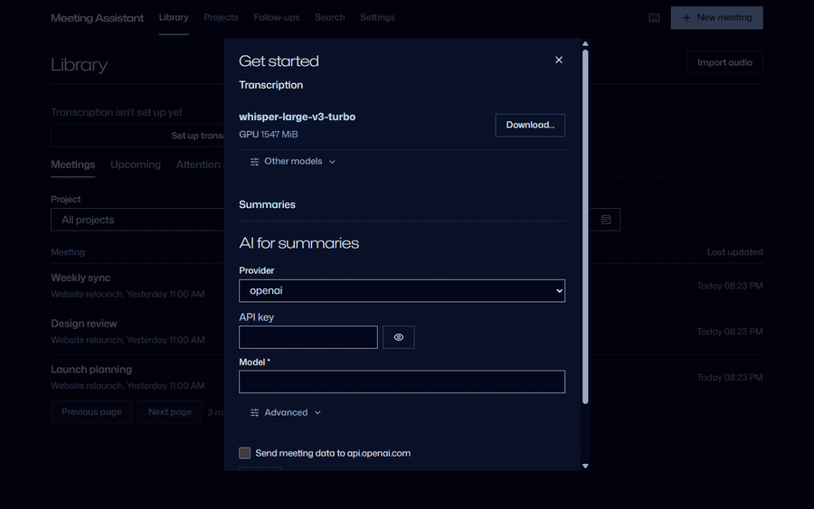
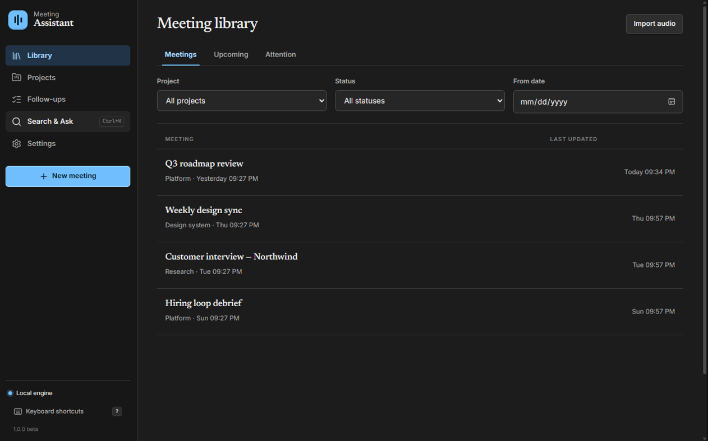
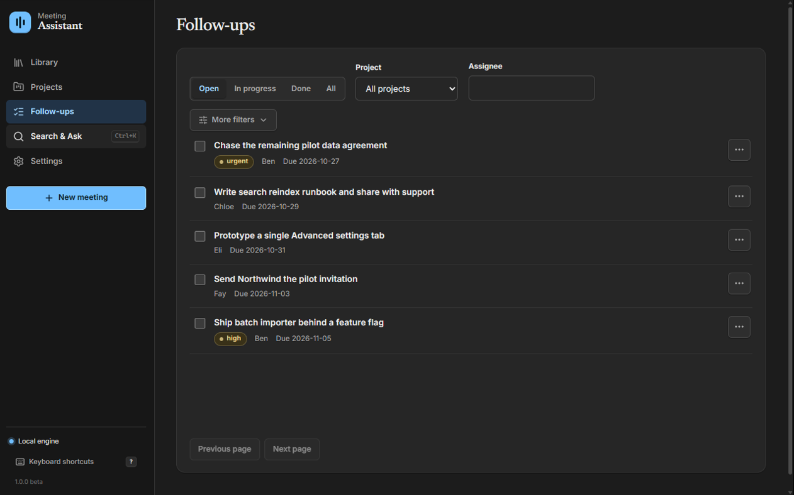
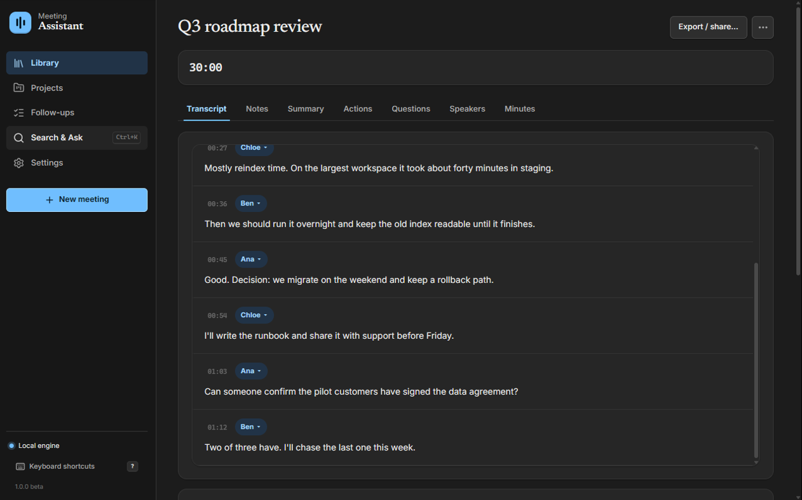
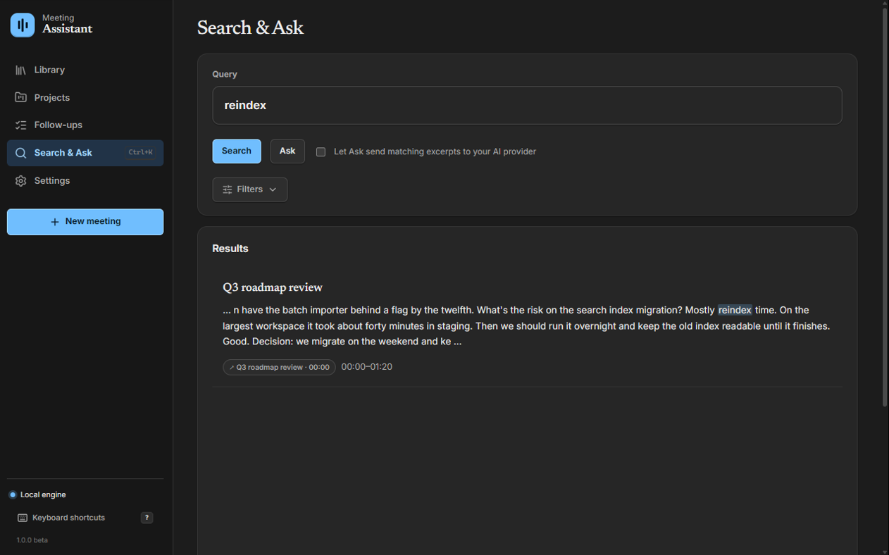
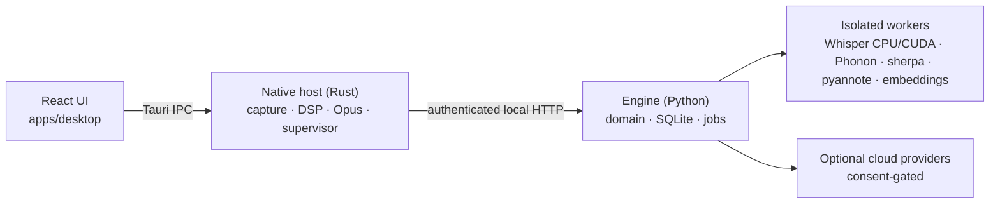

# Meeting Assistant

**Private meeting notes, transcribed on your own PC.** It records your microphone
and the call audio, transcribes them locally, labels who spoke, and turns the
conversation into actions, decisions and searchable notes that link back to the
moment they were said. No bot joins your call, there is no account, and nothing
is captured until you press Start. An open-source, local alternative to Otter.ai,
Fireflies or Granola.

**[Download for Windows](https://github.com/joactr/meeting-assistant/releases/latest)** · [Privacy](docs/privacy.md) · [Troubleshooting](docs/troubleshooting.md)

<p align="center">
  
</p>

> **Beta, Windows 11 x64.** The installer is not code-signed, so SmartScreen warns on
> first launch: choose **More info → Run anyway**. Later versions are offered inside the
> app and are signature-checked before they install.

## Highlights

- **Runs on your machine.** Speech recognition runs locally on the CPU, or on an NVIDIA GPU with the optional CUDA pack (Whisper large-v3-turbo: an 8 s clip in 0.25 s on an RTX 4090, 7.8 s on CPU).
- **Pick your model.** Whisper small, large-v3 and large-v3-turbo; Parakeet; Phonon-2.5 (25 languages, 156 MB). Models download on demand, pinned to an exact revision, after you accept their license.
- **Knows who spoke.** Microphone and system audio are captured separately (WASAPI loopback); optional pyannote diarization separates remote speakers. Speakers and text are editable, with revision history and undo.
- **Actions with receipts.** Actions, decisions, risks and important moments each cite the transcript line they came from, and follow-ups are tracked across meetings. AI summaries and extraction use the LLM you choose: local Ollama, or your own OpenAI, Anthropic, Gemini or Azure key. Cloud use is opt-in per destination.
- **Find anything.** Keyword search, plus optional semantic search and Ask, over every meeting, with answers that cite excerpts.
- **Keep it yours.** Export Markdown, PDF or SRT; hash-verified backup and restore. Recording audio to disk is off by default.

| Meeting library | Follow-ups across meetings |
|---|---|
|  |  |

| Meeting transcript | Search with transcript evidence |
|---|---|
|  |  |

Screenshots use a synthetic demo workspace; no real meeting data.

## Architecture



- `engine/`: Python 3.12 engine, SQLite with migrations, command registry and HTTP transport.
- `crates/`: audio backends (WASAPI; experimental CoreAudio and PipeWire), SpeexDSP and Silero VAD, Opus media, worker protocol.
- `apps/desktop/`: React with TanStack Query, plus the Tauri 2 host.
- `workers/`: independently locked, frozen inference workers.
- `engine/contracts/`: OpenAPI, JSON Schema, TypeScript and Rust types generated from the engine.
- `engine/prompts/`, `engine/catalog/`: versioned prompt templates and model/runtime manifests.

## Platform status

| Platform | Status | Intended system-audio backend |
|---|---|---|
| Windows 11 x86-64 | Primary verification target; see recorded acceptance evidence | WASAPI shared-mode loopback |
| macOS 15+ arm64/x86-64 | **Experimental and untested** | ScreenCaptureKit audio and CoreAudio microphone |
| Ubuntu 24.04 x86-64 | **Experimental and untested** | PipeWire monitor nodes |

macOS and Linux cannot currently be tested by the maintainer in this environment.
Source presence or successful compilation is not a guarantee of capture,
permissions, playback, packaging or update behavior on those systems.

## Development

Required toolchains are pinned in `engine/.python-version`,
`apps/desktop/.node-version` and `rust-toolchain.toml`. Install Python 3.12.10, Node 24.22.1, Rust 1.94.0, uv 0.13.5
and just 1.59.0. Windows native builds additionally require Visual Studio C++
build tools and WebView2. Native codec SDK prerequisites are documented in
[platform setup](docs/platforms.md).

```text
just bootstrap
just dev
```

The engine is a Python package under `engine/meeting_assistant`; the React
application is in `apps/desktop`; the Tauri host and native audio/media crates
are separate from engine business logic. Workspaces use application-data
locations, never an implicit database in the current working directory.

## Verification

```text
just check
just test
just smoke
just build
just package
just release-check
```

These commands propagate failures. `smoke` exercises a real local engine,
native deterministic file-source processing, and the actual browser surface.
It does not replace real microphone/system capture, credentialed provider,
installed-desktop, OAuth or signed-upgrade acceptance. Command receipts are
written under ignored `artifacts/`; missing acceptance evidence is not a pass.

## Privacy and inference

Capture always needs an explicit Start. Retained recording is separately
opt-in and off by default; recording off must not create an audio crash journal.
Optional AI, embeddings and diarization must not prevent basic notebook use.
The selected ASR must be ready before capture transcription starts; no silent
provider switch is permitted.

Large models and inference runtimes require explicit acquisition. An empty
installation is not offline-inference-ready. Connections use user-provided
credentials and declared destinations; no project-operated inference account
or company gateway is required. Cloud processing and delivery are distinct
consents. Read [privacy](docs/privacy.md) before using real meeting data.

Source and identity-less developer builds can explicitly install a first-party
worker into a private, workspace/model-scoped native-code registry. This is a
separate developer action, not an unsigned official catalog or an executable
model import. See [Windows developer setup](docs/providers.md#windows-developer-worker-setup).
It does not make an empty installation ready or satisfy signed-release gates.

## Distribution

Windows releases are published on [GitHub Releases](https://github.com/joactr/meeting-assistant/releases)
with `just release-local <version>` (see [releases](docs/releases.md)). Runtime
pack descriptors are Ed25519-signed, model files are SHA-256 pinned, and app
updates are signed with the Tauri updater key. The installer itself has no
Authenticode signature.

Original application source uses MIT. Dependencies, codecs and model weights
retain their own licenses; see the generated artifact inventories.

## Model credits

No model weights ship in the installer. Each model is downloaded on request,
pinned to an exact revision, after you accept its license.

| Model | Author | License | Changes |
|---|---|---|---|
| [Whisper small](https://huggingface.co/Systran/faster-whisper-small) | OpenAI; CTranslate2 conversion by SYSTRAN | [MIT](https://github.com/openai/whisper/blob/main/LICENSE) | Format conversion only |
| [Whisper large-v3-turbo](https://huggingface.co/mobiuslabsgmbh/faster-whisper-large-v3-turbo) | OpenAI; CTranslate2 conversion by Mobius Labs | [MIT](https://github.com/openai/whisper/blob/main/LICENSE) | Format conversion only |
| [Whisper large-v3](https://huggingface.co/Systran/faster-whisper-large-v3) | OpenAI; CTranslate2 conversion by SYSTRAN | [MIT](https://github.com/openai/whisper/blob/main/LICENSE) | Format conversion only |
| [Parakeet TDT 0.6B v3](https://huggingface.co/nvidia/parakeet-tdt-0.6b-v3) | NVIDIA | [CC BY 4.0](https://creativecommons.org/licenses/by/4.0/) | Converted to ONNX and int8-quantized by the [sherpa-onnx](https://huggingface.co/csukuangfj/sherpa-onnx-nemo-parakeet-tdt-0.6b-v3-int8) project |
| [Phonon-2.5](https://huggingface.co/FermionResearch/Phonon-2.5) | Fermion Research, derived from NVIDIA Parakeet TDT 0.6B v3 | [CC BY 4.0](https://creativecommons.org/licenses/by/4.0/) | Re-trained for 25 languages and compressed by Fermion Research ([NOTICE](https://huggingface.co/FermionResearch/Phonon-2.5/blob/main/NOTICE)) |
| [speaker-diarization-community-1](https://huggingface.co/pyannote/speaker-diarization-community-1) | pyannote | [CC BY 4.0](https://creativecommons.org/licenses/by/4.0/) | None. Gated: each user accepts pyannote's terms on Hugging Face |
| [multilingual-e5-small](https://huggingface.co/intfloat/multilingual-e5-small) | Microsoft (intfloat) | [MIT](https://github.com/microsoft/unilm/blob/master/LICENSE) | None |

Runtimes: [faster-whisper](https://github.com/SYSTRAN/faster-whisper) (MIT),
[sherpa-onnx](https://github.com/k2-fsa/sherpa-onnx) (Apache-2.0),
[fermion-research](https://pypi.org/project/fermion-research/) (Apache-2.0) with
[PyTorch](https://pytorch.org) (BSD-3-Clause),
[pyannote.audio](https://github.com/pyannote/pyannote-audio) (MIT),
[ONNX Runtime](https://github.com/microsoft/onnxruntime) (MIT). The optional
GPU Whisper pack also contains NVIDIA cuBLAS, cuDNN and NVRTC under NVIDIA's own
license terms, included in the pack; those files are not MIT. The optional
Azure Speech pack uses Microsoft's Speech SDK license.

## Accuracy

Transcripts, speaker labels, summaries, actions and answers are produced by
machine-learning models and can be wrong, incomplete or attributed to the wrong
person. Check them against the source audio before relying on them, and do not
use them as the sole basis for legal, medical, employment or financial
decisions. The software is provided "as is", without warranty (see `LICENSE`).
